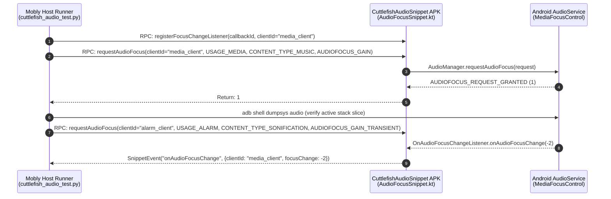

# Cuttlefish End-to-End Audio Test Suite (`cuttlefish-audio-test`)

This directory contains the Mobly end-to-end (E2E) audio validation suite and on-device JSON-RPC snippet helper app for Cuttlefish virtual devices.

---

## 1. Architecture Overview

The test suite uses the standard AOSP **Mobly + `mobly-snippet-lib`** architecture:
- **Host Runner ([`cuttlefish_audio_test.py`](cuttlefish_audio_test.py))**: Python Mobly test suite executed on the host machine via Tradefed (`MoblyBinaryHostTest`).
- **On-Device Snippet APK ([`CuttlefishAudioSnippet`](app/src/com/android/cuttlefish/audiotest/AudioFocusSnippet.kt))**: Instrumentation helper app (`com.android.cuttlefish.audiotest`) exposing Android `AudioManager` APIs over JSON-RPC (`@Rpc` and `@AsyncRpc`).
- **Per-Client State Isolation**: Every snippet RPC is keyed by an explicit `clientId: String`, allowing a single instrumentation process to simulate multiple independent audio apps requesting, losing, ducking, and regaining focus concurrently.



---

## 2. Directory Structure & Build Targets

| Path | Build Target / Role | Description |
| :--- | :--- | :--- |
| [`Android.bp`](Android.bp) | `cuttlefish-audio-test` / `cuttlefish-audio-mode-session-test` (`python_test_host`) | Host Python test binaries bundling `mobly`, `cuttlefish-audio-stack-inspector`, and `:CuttlefishAudioSnippet`. |
| [`AndroidTest.xml`](AndroidTest.xml) | Tradefed Configuration (`cuttlefish-audio-test`) | Installs `CuttlefishAudioSnippet.apk` (`-r -g`) via `SuiteApkInstaller` and runs `MoblyBinaryHostTest`. |
| [`AudioModeSessionTest.xml`](AudioModeSessionTest.xml) | Tradefed Configuration (`cuttlefish-audio-mode-session-test`) | Installs `CuttlefishAudioSnippet.apk` (`-r -g`) and runs the 5-layer VoIP `AudioModeSession` E2E test suite. |
| [`audio_stack_inspector.py`](audio_stack_inspector.py) | `cuttlefish-audio-stack-inspector` (`python_library_host`) | Correlates 5 guest audio layers (`dumpsys audio`, `dumpsys media.audio_policy`, `dumpsys media.audio_flinger`, and `/proc/asound/card0/pcm*/sub0/status`). |
| [`audio_stack_inspector_test.py`](audio_stack_inspector_test.py) | `cuttlefish-audio-stack-inspector-test` (`python_test_host`) | Host unit tests for `audio_stack_inspector.py` parsers and route convergence logic. |
| [`audio_test_base.py`](audio_test_base.py) | `cuttlefish-audio-test-base` (`python_library_host`) | Shared Mobly base class (`CuttlefishAudioTestBase`) providing snippet initialization, `AudioStackInspector` wiring, 5-layer route assertion helpers (`_assert_5_layer_route`), per-test isolation, and failure diagnostics. |
| [`cuttlefish_audio_test.py`](cuttlefish_audio_test.py) | `CuttlefishAudioFocusTest` | Data-driven Mobly test suite verifying focus acquisition, active stack state, and async callbacks. |
| [`audio_mode_session_test.py`](audio_mode_session_test.py) | `CuttlefishVoipModeSessionTest` | E2E VoIP `AudioModeSession` routing, mid-call Speaker/Earpiece switching, media preemption, and cellular call (`MODE_IN_CALL`) preemption tests. |
| [`app/Android.bp`](app/Android.bp) | `CuttlefishAudioSnippet` (`android_test_helper_app`) | On-device helper APK built with `platform_apis: true` and `mobly-snippet-lib`. |
| [`app/AndroidManifest.xml`](app/AndroidManifest.xml) | Package `com.android.cuttlefish.audiotest` | Declares `SnippetRunner` instrumentation (`AudioFocusSnippet`, `AudioModeSessionSnippet`) and audio permissions. |
| [`app/src/.../AudioFocusSnippet.kt`](app/src/com/android/cuttlefish/audiotest/AudioFocusSnippet.kt) | `AudioFocusSnippet` | Implements `@Rpc` and `@AsyncRpc` focus methods with thread-safe (`@GuardedBy("lock")`) request tracking. |
| [`app/src/.../AudioModeSessionSnippet.kt`](app/src/com/android/cuttlefish/audiotest/AudioModeSessionSnippet.kt) | `AudioModeSessionSnippet` | Wraps `android.media.AudioModeSession` session-based mode/route control and continuous 48 kHz sine-wave `AudioTrack` streaming. |
| [`app/src/.../DyingFocusHolderService.kt`](app/src/com/android/cuttlefish/audiotest/DyingFocusHolderService.kt) | `DyingFocusHolderService` | Helper `Service` running in `:dying_focus_client` child process to test Binder death cleanup (`AudioFocusDeathHandler.binderDied()`). |

---

## 3. Snippet RPC API Reference (`CuttlefishAudioSnippet`)

### 3.1 `AudioFocusSnippet` RPCs

| Method | Type | Parameters | Return / Event Payload | Description |
| :--- | :---: | :--- | :--- | :--- |
| `requestAudioFocus` | `@Rpc` | `clientId: String`, `usage: Int`, `contentType: Int`, `focusGain: Int` | `Int` (`GRANTED=1`, `FAILED=0`, `DELAYED=2`) | Builds an `AudioFocusRequest` for `clientId`, requests focus, and appends the request to `activeRequests[clientId]`. |
| `requestAudioFocusInChildProcess` | `@Rpc` | `usage: Int`, `contentType: Int`, `focusGain: Int` | `Int` (child process PID, or `-1` on failure) | Starts `DyingFocusHolderService` in dedicated process `:dying_focus_client`, acquires audio focus, and returns the child OS process PID. |
| `killChildProcess` | `@Rpc` | *(none)* | `Int` (killed PID, or `-1` if not running) | Sends same-UID `SIGKILL` (`Process.killProcess`) to `:dying_focus_client` and stops `DyingFocusHolderService` without requiring `adb root`. |
| `abandonAudioFocus` | `@Rpc` | `clientId: String` | `Int` (`GRANTED=1`, `FAILED=0`) | Removes `callbackIds[clientId]` and abandons all `AudioFocusRequest` instances tracked under `clientId`. |
| `abandonAllAudioFocus` | `@Rpc` | *(none)* | `Unit` | Abandons all active `AudioFocusRequest`s across all `clientId`s and clears all registered callbacks. Called automatically in `setup_test` and `teardown_test`. |
| `registerFocusChangeListener` | `@AsyncRpc` | `callbackId: String` *(auto-injected by Mobly)*, `clientId: String` | `SnippetEvent` (`eventName="onAudioFocusChange"`) | Registers an asynchronous listener that posts `{ "clientId": String, "focusChange": Int }` whenever `onAudioFocusChange` fires for `clientId`. |
| `unregisterFocusChangeListener` | `@Rpc` | `clientId: String` | `Unit` | Unregisters the `callbackId` associated with `clientId`. |

### 3.2 `AudioModeSessionSnippet` RPCs

| Method | Type | Parameters | Return | Description |
| :--- | :---: | :--- | :--- | :--- |
| `isModeSessionSupported` | `@Rpc` | *(none)* | `Boolean` | Returns `Flags.fusedTelecomRouteApi()`. |
| `getOutputDeviceTypes` | `@Rpc` | *(none)* | `List<Int>` | Returns output `AudioDeviceInfo.type` values from `AudioManager.getDevices(GET_DEVICES_OUTPUTS)`. |
| `createModeSession` | `@Rpc` | `sessionId: String`, `initialMode: Int`, `isDisplayActiveUseCase: Boolean` | `Int` (routed `primaryDevice.type`) | Builds an `AudioModeSession.Request.Builder`, calls `audioManager.createAudioModeSession(request, callbackExecutor, callback)`, and awaits `onAvailableRoutesChanged`, `onResumed`, and `onRoutingResult`. |
| `getSessionAvailableRouteTypes` | `@Rpc` | `sessionId: String` | `List<Int>` | Returns `primaryDevice.type` values from `session.availableRoutes`. |
| `requestSessionRouteByType` | `@Rpc` | `sessionId: String`, `deviceType: Int` | `Int` (applied `primaryDevice.type`) | Calls `session.setRequestedRoute(targetRoute)` and awaits the matching `onRoutingResult`. |
| `setSessionDisplayActiveUseCase` | `@Rpc` | `sessionId: String`, `isDisplayActiveUseCase: Boolean` | `Int` (applied `primaryDevice.type`) | Calls `session.setDisplayActiveUseCase(isDisplayActiveUseCase)` and awaits the default-route `onRoutingResult` (requires default routing to be active and the default route to change). |
| `awaitSessionPaused` | `@Rpc` | `sessionId: String` | `Boolean` | Awaits `onPaused()` when a higher-priority session (e.g. `MODE_IN_CALL`) preempts `sessionId`. |
| `awaitSessionResumedAndRouted` | `@Rpc` | `sessionId: String` | `Int` (restored `primaryDevice.type`) | Awaits `onResumed(requestId)` and its matching `onRoutingResult(requestId)` after a preempting session closes. |
| `closeModeSession` / `closeAllModeSessions` | `@Rpc` | `sessionId: String` / *(none)* | `Unit` | Calls `session.close()` and awaits `onClosed()` for one or all tracked `AudioModeSession` instances. |
| `startPlayback` / `stopPlayback` / `stopAllPlayback` | `@Rpc` | `streamId: String`, `usage: Int`, `contentType: Int` / `streamId: String` / *(none)* | `Unit` | Starts or stops continuous 400 Hz 48 kHz mono PCM16 `AudioTrack` playback so AudioFlinger and ALSA/VirtIO-Snd streams are actively running. |

---

## 4. Current Test Inventory (14 Tests Across 2 Modules)

### 4.1 `cuttlefish-audio-test`: Data-Driven Single-Client Use-Case Matrix (`self.generate_tests`)

Each generated test in `CuttlefishAudioFocusTest`:
1. Calls `requestAudioFocus(use_case, usage, content_type, focus_gain)` and asserts the return code matches `AUDIOFOCUS_REQUEST_GRANTED` (`1`).
2. Inspects `adb shell dumpsys audio` between `Audio Focus stack entries (last is top of stack):` and the stack terminator (`No external focus policy` / `External focus policy:` / ` Notify on duck:`) to verify `CfAudioTest[<use_case>]` is present in the **live** focus stack (excluding historical `mEventLogger` records).
3. Calls `abandonAudioFocus(use_case)` and asserts `AUDIOFOCUS_REQUEST_GRANTED` (`1`).
4. Re-inspects the live `dumpsys audio` focus stack and asserts `CfAudioTest[<use_case>]` has been removed.

| Generated Test Name | `AudioAttributes.Usage` | `AudioAttributes.ContentType` | `FocusGain` | Expected Result |
| :--- | :--- | :--- | :--- | :---: |
| `test_audio_focus_media` | `USAGE_MEDIA` (`1`) | `CONTENT_TYPE_MUSIC` (`2`) | `AUDIOFOCUS_GAIN` (`1`) | `GRANTED` (`1`) |
| `test_audio_focus_voice_communication` | `USAGE_VOICE_COMMUNICATION` (`2`) | `CONTENT_TYPE_SPEECH` (`1`) | `AUDIOFOCUS_GAIN_TRANSIENT` (`2`) | `GRANTED` (`1`) |
| `test_audio_focus_navigation` | `USAGE_ASSISTANCE_NAVIGATION_GUIDANCE` (`12`) | `CONTENT_TYPE_SPEECH` (`1`) | `AUDIOFOCUS_GAIN_TRANSIENT_MAY_DUCK` (`3`) | `GRANTED` (`1`) |
| `test_audio_focus_alarm` | `USAGE_ALARM` (`4`) | `CONTENT_TYPE_SONIFICATION` (`4`) | `AUDIOFOCUS_GAIN_TRANSIENT` (`2`) | `GRANTED` (`1`) |
| `test_audio_focus_notification` | `USAGE_NOTIFICATION` (`5`) | `CONTENT_TYPE_SONIFICATION` (`4`) | `AUDIOFOCUS_GAIN_TRANSIENT_MAY_DUCK` (`3`) | `GRANTED` (`1`) |
| `test_audio_focus_game` | `USAGE_GAME` (`14`) | `CONTENT_TYPE_SONIFICATION` (`4`) | `AUDIOFOCUS_GAIN` (`1`) | `GRANTED` (`1`) |

### 4.2 `cuttlefish-audio-test`: Multi-Client Asynchronous Callback & Process Death Validation

| Test Method Name | Scenario Verified |
| :--- | :--- |
| `test_audio_focus_change_listener_callback` | Registers `@AsyncRpc` listener on `media_client` $\rightarrow$ acquires `AUDIOFOCUS_GAIN` on `media_client` $\rightarrow$ interrupts with `AUDIOFOCUS_GAIN_TRANSIENT` on `alarm_client` $\rightarrow$ verifies `media_client` receives `AUDIOFOCUS_LOSS_TRANSIENT` (`-2`) via `handler.waitAndGet('onAudioFocusChange')` $\rightarrow$ abandons `alarm_client` $\rightarrow$ verifies `media_client` receives `AUDIOFOCUS_GAIN` (`1`). |
| `test_audio_focus_same_client_multiple_requests` | Acquires `AUDIOFOCUS_GAIN` followed by `AUDIOFOCUS_GAIN_TRANSIENT` on `media_client` $\rightarrow$ verifies both `TaggedFocusListener` instances (`CfAudioTest[media_client]#<seq>`) remain distinct in the live `dumpsys audio` focus stack $\rightarrow$ calls `abandonAudioFocus("media_client")` $\rightarrow$ verifies all `CfAudioTest[media_client]` entries are removed. |
| `test_audio_focus_cleanup_on_client_death` | Acquires `AUDIOFOCUS_GAIN` on `media_client` in the main process $\rightarrow$ starts `DyingFocusHolderService` in dedicated child process `:dying_focus_client` holding `AUDIOFOCUS_GAIN_TRANSIENT` $\rightarrow$ verifies `media_client` receives `AUDIOFOCUS_LOSS_TRANSIENT` (`-2`) and `CfAudioTest[dying_child]` is stacked above `CfAudioTest[media_client]` in `dumpsys audio` $\rightarrow$ abruptly terminates `:dying_focus_client` via `killChildProcess()` (`Process.killProcess` `SIGKILL`) without `abandonAudioFocus()` $\rightarrow$ verifies `MediaFocusControl`'s `AudioFocusDeathHandler.binderDied()` purges `CfAudioTest[dying_child]` from `dumpsys audio` and dispatches `AUDIOFOCUS_GAIN` (`1`) back to `media_client`. |

### 4.3 `cuttlefish-audio-mode-session-test`: 5-Layer VoIP `AudioModeSession` Routing & Preemption Suite

Every route assertion in `CuttlefishVoipModeSessionTest` validates all **5 guest audio stack layers** simultaneously via `AudioStackInspector`:
1. **Layer 1 (`dumpsys audio`)**: `Actual mode` (`MODE_NORMAL`, `MODE_IN_COMMUNICATION`, `MODE_IN_CALL`) and live `AudioModeSession` state (`isLive`, `hasFocus`, `requestedRoute`, `appliedRoute`).
2. **Layer 2 (`dumpsys media.audio_policy` — `ProductStrategies`)**: Active device type (`AUDIO_DEVICE_OUT_SPEAKER` vs `AUDIO_DEVICE_OUT_EARPIECE`) and address (`CARD_0_DEV_0` vs `CARD_0_DEV_1`) for `STRATEGY_PHONE` / `STRATEGY_MEDIA`.
3. **Layer 3 (`dumpsys media.audio_policy` — `AudioPatches`)**: Active hardware sink patch targeting `CARD_0_DEV_0` or `CARD_0_DEV_1`.
4. **Layer 4 (`dumpsys media.audio_flinger`)**: Non-standby `OutputThread` routed to the target device with monotonically advancing `Frames written`.
5. **Layer 5 (`/proc/asound/card0/pcm*/sub0/status`)**: Active ALSA/VirtIO-Snd substream (`pcm0p` for Speaker, `pcm1p` for Earpiece) in `state: RUNNING` while the unselected substream is closed/inactive.

| Test Method Name | Scenario Verified |
| :--- | :--- |
| `test_dumpsys_format_contract` | Fast presubmit format contract gate (~350 ms) that opens a brief `AudioModeSession` (`MODE_IN_COMMUNICATION`), starts `AudioTrack` playback, and verifies live `dumpsys audio`, `dumpsys media.audio_policy`, `dumpsys media.audio_flinger`, and `/proc/asound/card0/pcm*/sub0/status` outputs satisfy all `AudioStackInspector` section anchors and regex parsers. |
| `test_voip_mode_session_default_voice_vs_video_routing` | Verifies `AudioModeSession` (`MODE_IN_COMMUNICATION`) with `isDisplayActiveUseCase=false` (voice VoIP) defaults to Built-In Earpiece (`CARD_0_DEV_1` / `pcm1p`), and toggling `setDisplayActiveUseCase(true)` (video VoIP) re-routes all 5 layers to Built-In Speaker (`CARD_0_DEV_0` / `pcm0p`). |
| `test_voip_mode_session_mid_call_route_switching` | Verifies mid-call switching via `AudioModeSession.setRequestedRoute()` from Earpiece (`pcm1p`) $\rightarrow$ Speaker (`pcm0p`) $\rightarrow$ Earpiece (`pcm1p`) across all 5 guest audio layers. |
| `test_voip_mode_session_preempts_and_restores_media_playback` | Starts `USAGE_MEDIA` playback with `AUDIOFOCUS_GAIN` on Speaker (`pcm0p`) $\rightarrow$ opens a VoIP `AudioModeSession` (`MODE_IN_COMMUNICATION`) $\rightarrow$ verifies media receives `AUDIOFOCUS_LOSS_TRANSIENT` (`-2`) and VoIP streams on Earpiece (`pcm1p`) $\rightarrow$ closes the VoIP session $\rightarrow$ verifies media receives `AUDIOFOCUS_GAIN` (`1`) and resumes streaming on Speaker (`pcm0p`). |
| `test_voip_mode_session_preempted_by_cellular_call_and_restored` | Starts a VoIP `AudioModeSession` (`MODE_IN_COMMUNICATION`) streaming on Earpiece (`pcm1p`) $\rightarrow$ opens a cellular call `AudioModeSession` (`MODE_IN_CALL`) routed to Speaker (`pcm0p`) $\rightarrow$ verifies the VoIP session receives `onPaused()` while `STRATEGY_PHONE` switches to `MODE_IN_CALL` on Speaker (`pcm0p`) $\rightarrow$ closes the `MODE_IN_CALL` session $\rightarrow$ verifies the VoIP session automatically resumes (`onResumed()` + `onRoutingResult()`) and restores `MODE_IN_COMMUNICATION` routing on Earpiece (`pcm1p`). |

---

## 5. Build & Run Commands

### Build & Run Full Suites via `atest`
```bash
m CuttlefishAudioSnippet cuttlefish-audio-test cuttlefish-audio-mode-session-test
ANDROID_SERIAL=<ip>:<port> atest cuttlefish-audio-test cuttlefish-audio-mode-session-test --request-upload-result
```

### Fast Test Iteration (`atest -it`)
When iterating after building `CuttlefishAudioSnippet`, `cuttlefish-audio-test`, and `cuttlefish-audio-mode-session-test`:
```bash
ANDROID_SERIAL=<ip>:<port> atest -it cuttlefish-audio-test cuttlefish-audio-mode-session-test --request-upload-result
```

### Run a Single Test Method
```bash
ANDROID_SERIAL=<ip>:<port> atest -it cuttlefish-audio-mode-session-test:CuttlefishVoipModeSessionTest#test_voip_mode_session_mid_call_route_switching --request-upload-result
```

### List All Generated Mobly Tests Without Running on Device
```bash
out/host/linux-x86/testcases/cuttlefish-audio-test/x86_64/cuttlefish-audio-test --list_tests
out/host/linux-x86/testcases/cuttlefish-audio-mode-session-test/x86_64/cuttlefish-audio-mode-session-test --list_tests
```

---

## 6. Standard Procedure for Simulated Suppressed Performance (1 CPU Core) & Stress Testing

To validate time-sensitive audio routing, focus arbitration, and frame advancement checks under non-premium / heavily throttled cloud instances, run the suites with the Cuttlefish guest constrained to **1 active vCPU (`cpu0`)** via Linux CPU hotplug (`/sys/devices/system/cpu/cpu[1-N]/online`).

### 6.1 Step-by-Step 1-Core Stress Test Procedure
```bash
export ANDROID_SERIAL=<ip>:<port>

# 1. Remove any stale orphaned logcat processes from interrupted prior runs
adb -s $ANDROID_SERIAL shell 'su 0 killall logcat 2>/dev/null || true'

# 2. Offline all secondary vCPUs (cpu1..cpuN) so only cpu0 remains online
adb -s $ANDROID_SERIAL shell 'su 0 sh -c "for f in /sys/devices/system/cpu/cpu[1-9]*/online; do [ -e \$f ] && echo 0 > \$f; done; cat /sys/devices/system/cpu/online; nproc"'
# Expected output:
#   0
#   1

# 3. Run single-pass or 100-iteration stress test under 1-core constraint
ANDROID_SERIAL=$ANDROID_SERIAL atest -it cuttlefish-audio-mode-session-test cuttlefish-audio-test --iterations 100 --request-upload-result

# 4. Always restore all vCPUs back online after testing
adb -s $ANDROID_SERIAL shell 'su 0 sh -c "for f in /sys/devices/system/cpu/cpu[1-9]*/online; do [ -e \$f ] && echo 1 > \$f; done; cat /sys/devices/system/cpu/online; nproc"'
# Expected output (on a 4-vCPU instance):
#   0-3
#   4
```

### 6.2 Timeout Sizing & Multi-Iteration Verification

Both suites were verified across 100 consecutive iterations on 4-core (`nproc=4`, `http://ab/I05100010640673808`) and 1-core (`nproc=1`, `http://ab/I35400010640768731`) Cuttlefish guests:
1. **10-Second Timeout & >= 250ms Polling Rule**:
   On a 1-core guest, real-time 48 kHz audio mixer threads (`AudioFlinger`), `system_server` (`AudioService`), `CuttlefishAudioSnippet`, and `adbd` (`dumpsys` inspection) contend for `cpu0`. All host and device callback/polling timeouts (`DEFAULT_TIMEOUT_SEC` / `DEFAULT_CALLBACK_TIMEOUT_MS`) are unified at **`10.0s`** with a **`250ms` (`DEFAULT_POLL_INTERVAL_SEC`)** polling interval so `dumpsys` polling does not saturate `cpu0` while absorbing single-core scheduling spikes without false timeouts.
2. **Explicit `self.dut.services.stop_all()` in `teardown_class`**:
   Stopping registered Mobly `logcat.Logcat` services at class teardown prevents orphaned on-device `logcat` processes from accumulating across `--iterations N` runs and degrading `cpu0` throughput.

---

## 7. Debugging Playbook & Common Pitfalls

### 7.1 Inspecting Live vs. Historical Audio Focus State on Device
`dumpsys audio` contains **both** the live focus stack and a rolling historical event log (`focus commands as seen by MediaFocusControl`).
- To inspect **only** the live focus stack manually:
  ```bash
  adb shell dumpsys audio | sed -n '/Audio Focus stack entries (last is top of stack):/,/ Notify on duck:/p'
  ```
- To inspect the historical focus command log:
  ```bash
  adb shell dumpsys audio | grep -A 25 "focus commands as seen by MediaFocusControl"
  ```

### 7.2 Streaming Device Logs During Test Execution
All snippet operations and server focus/routing transitions log under `AudioFocusSnippet`, `AudioModeSessionSnippet`, `AudioFocusChildSvc`, and `AudioSvc*` tags:
```bash
adb logcat -s AudioFocusSnippet:V AudioModeSessionSnippet:V AudioFocusChildSvc:V AudioSvc:V AudioSvc.FocusCtrl:V AudioSvc.FocusReq:V AudioSvc.ModeSession:V AudioSvc.DeviceBroker:V ActivityManager:I
```

### 7.3 Locating Mobly Host & Snippet Logs After a Test Run
ATest stores full Mobly debug logs (`test_summary.yaml`, `mobly_command_log`, and per-device logcat captures) under:
```bash
ls -la /tmp/atest_result_$USER/CURRENT/log/
```

### 7.4 Key Implementation Invariants & Native Mobly Facilities
1. **Standard CLI Parsing via `<option name="no-double-dash" value="true" />`**:
   In [`AndroidTest.xml`](AndroidTest.xml) and [`AudioModeSessionTest.xml`](AudioModeSessionTest.xml), `MoblyBinaryHostTest` sets `<option name="no-double-dash" value="true" />`. This prevents Tradefed from inserting a legacy `--` separator before `--list_tests` or `--config`, allowing the test runners to use pure standard `test_runner.main()` without any custom `sys.argv` munging.
2. **Targeted Per-Test Diagnostics on Failure (`logcat.Logcat` + `DUMPSYS_TARGETS`)**:
   - In `setup_class()`, `self.dut.services.register(..., logcat.Logcat, ...)` streams filtered audio logs continuously, and `teardown_class()` calls `self.dut.services.stop_all()` so `logcat` subprocesses are cleanly reaped after every class run.
   - In `on_fail(self, record)`, `self.dut.services.create_output_excerpts_all(self.current_test_info)` slices out the exact logcat excerpt for the failed test, and `DUMPSYS_TARGETS` captures `dumpsys audio`, `dumpsys media.audio_policy`, `dumpsys media.audio_flinger`, and `/proc/asound/card0/pcm*/sub0/status` into `self.current_test_info.output_path`.
3. **Device-Scoped Structured Logging (`self.dut.log`)**:
   Use `self.dut.log.info(...)` / `self.dut.log.debug(...)` to automatically prefix log entries with `[AndroidDevice|<serial>]` in Mobly's `test_log.INFO`.
4. **Thread Concurrency in `AudioFocusSnippet.kt` & `AudioModeSessionSnippet.kt`**:
   Listener callbacks execute on Android's main looper or dedicated executors, whereas `@Rpc` methods execute on `SnippetRunner` background binder/socket threads. All shared state maps remain synchronized under explicit locks or `ConcurrentHashMap`.
5. **Strict Test Isolation (`setup_test` + `teardown_test`)**:
   Both `setup_test` and `teardown_test` clean up active playback tracks, close all `AudioModeSession` instances, kill any child process, and abandon all focus requests before the next test starts.
